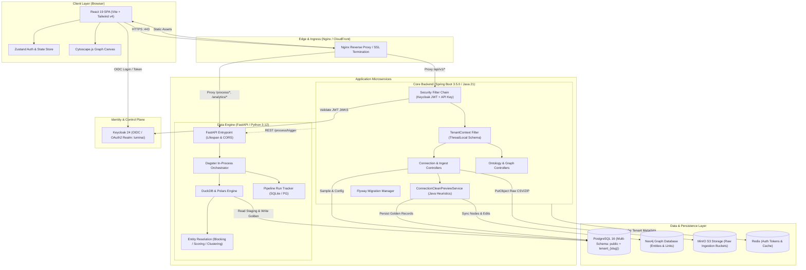
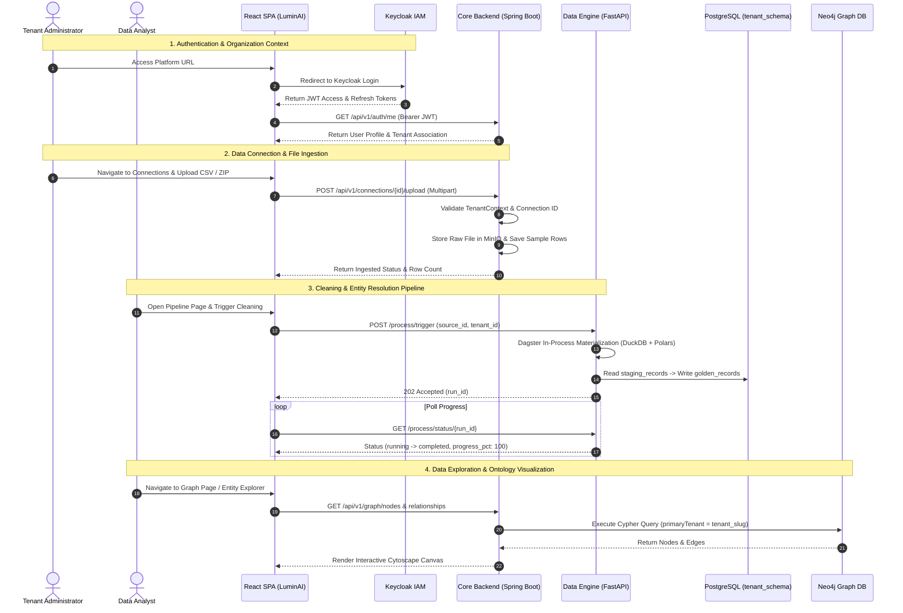
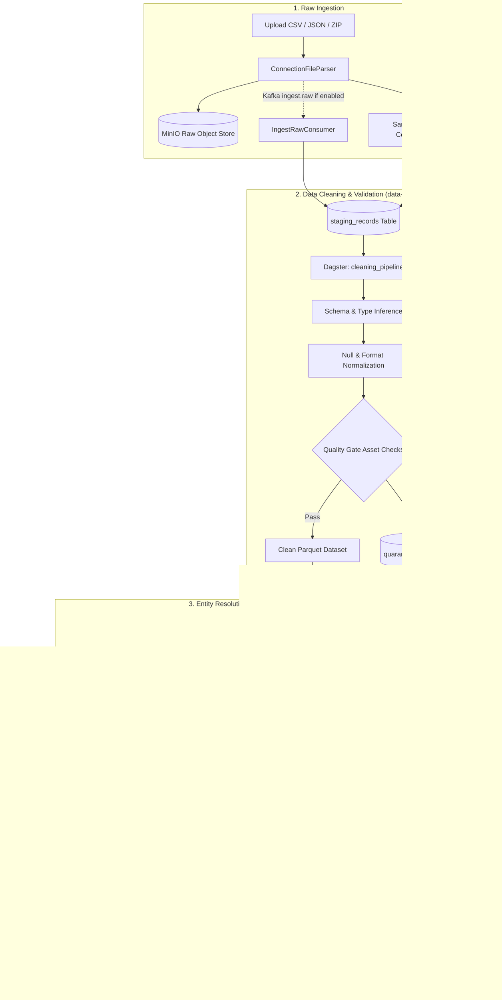

# LuminAI As-Built Technical Architecture & Operational Workflows

**Document Version:** 1.0.0  
**Audit Date:** November 2026  
**Auditor:** Senior Principal Enterprise Architect & DevSecOps Lead  

---

## 1. System Component Architecture

LuminAI is composed of three primary application tiers, backed by relational, graph, object, and key-value storage engines, with optional message queuing and telemetry exporters.



---

## 2. End-to-End User Journey



---

## 3. Data Ingestion, Processing & Entity Resolution Pipeline



---

## 4. Authentication, Authorization & Multi-Tenant Request Lifecycle

```mermaid
sequenceDiagram
    autonumber
    actor Client as Client Request (Browser / External API)
    participant Nginx as Edge Reverse Proxy
    participant SecFilter as Spring Security Filter Chain
    participant TenantFilter as TenantContext Filter
    participant Controller as REST Controller
    participant Hibernate as Hibernate MultiTenancy (SCHEMA)
    participant Postgres as PostgreSQL Database

    Client->>Nginx: HTTP Request with Headers:
    Note over Client,Nginx: Authorization: Bearer <Keycloak_JWT><br/>OR X-API-Key: <lum_live_hash><br/>X-Tenant-ID: acme-corp
    
    Nginx->>SecFilter: Forward Request

    alt Bearer JWT Provided
        SecFilter->>SecFilter: Validate JWT Signature against Keycloak JWKS
        SecFilter->>SecFilter: Extract Realm Roles (ADMIN, USER, etc.)
    else X-API-Key Provided
        SecFilter->>SecFilter: Compute SHA-256 Hash of Key
        SecFilter->>Postgres: SELECT * FROM public.api_keys WHERE hash = ?
        SecFilter->>SecFilter: Load Tenant & Assign OPERATOR Role
    end

    SecFilter->>TenantFilter: Forward with Authentication Context
    TenantFilter->>TenantFilter: Extract Tenant UUID & Slug from Token or Header
    TenantFilter->>TenantFilter: Set ThreadLocal: TenantContext.setTenant(uuid, slug)
    
    TenantFilter->>Controller: Invoke Endpoint (@PreAuthorize Check)
    Controller->>Hibernate: Execute JPA Query (e.g. goldenRecordRepository.findAll())
    Hibernate->>Hibernate: Resolve Current Tenant: "tenant_" + TenantContext.getTenantSlug()
    Hibernate->>Postgres: SET search_path TO "tenant_acme", "public"
    Hibernate->>Postgres: SELECT * FROM golden_records ...
    Postgres-->>Hibernate: Return Tenant-Isolated Data
    Hibernate-->>Controller: Entities
    Controller-->>Client: 200 OK JSON Response
    
    TenantFilter->>TenantFilter: finally { TenantContext.clear(); }
```

---

## 5. External Service and Database Dependencies

```mermaid
graph LR
    subgraph AppCore["LuminAI Application Core"]
        CB["core-backend (Java 21)"]
        DE["data-engine (Python 3.12)"]
        FE["frontend (React 19)"]
    end

    subgraph StorageDependencies["Storage & Graph Dependencies"]
        PG["PostgreSQL 16"]
        N4J["Neo4j 5.x"]
        MIO["MinIO S3 API"]
        RDS["Redis 7.x"]
    end

    subgraph IntegrationDependencies["Message & Ingress Dependencies"]
        KC["Keycloak 24"]
        KFK["Apache Kafka 3.7"]
        OS["OpenSearch 2.x"]
    end

    CB -->|JDBC :5432| PG
    CB -->|Bolt :7687| N4J
    CB -->|S3 REST :9000| MIO
    CB -->|RESP :6379| RDS
    CB -->|OIDC JWKS :8180| KC
    CB -->|TCP :9092 (Optional)| KFK
    CB -->|HTTP REST :8000| DE

    DE -->|SQLAlchemy :5432| PG
    DE -->|S3 REST :9000| MIO
    DE -->|Kafka Consumer :9092 (Optional)| KFK
    DE -->|HTTP :9200 (Optional)| OS

    FE -->|HTTP :8080| CB
    FE -->|HTTP :8000| DE
    FE -->|OIDC :8180| KC
```

---

## 6. Architectural Weaknesses and Known Discrepancies

### Weakness 1: Divergent Cleaning Implementations
- **Issue:** `ConnectionCleanPreviewService.java` implements in-memory string routines (title casing names, lowercase emails, naive confidence scoring), while `data-engine` contains a production-grade Polars/DuckDB cleaning pipeline with validation checks.
- **Risk:** Clean preview shown in the UI may not match the actual data materialized into golden records by the batch pipeline.
- **Remediation:** Phase out the Java cleaning heuristics; proxy preview requests directly to `data-engine`'s DuckDB in-memory sampler.

### Weakness 2: Dual Table Schemas (Public vs Multi-Schema)
- **Issue:** Core backend Flyway creates `golden_records` inside `tenant_{slug}` with columns `id`, `canonical_name`, `properties` JSONB. Data Engine Alembic creates `staging_records` and `golden_records` in `public` with `golden_id` VARCHAR and `attributes` TEXT.
- **Risk:** Data engine must dynamically inspect columns (`is_postgres_schema = "canonical_name" in cols`) to reconcile differences.
- **Remediation:** Standardize table models across both services into `tenant_{slug}`.

### Weakness 3: Memory Footprint vs Budget Reality
- **Issue:** Running Postgres, Neo4j, Redis, MinIO, Keycloak, Kafka, Zookeeper, OpenSearch, Dagster daemon, Spring Boot, and FastAPI simultaneously requires >12GB RAM, costing ~$150-$300/month on AWS or Render. The project target budget is ~GHS 10,000/year (~$700/year, ~$58/month).
- **Remediation:** The production Lightsail profile (`docker-compose.prod.yml`) correctly disables Kafka, Zookeeper, and OpenSearch. Further consolidation should run Keycloak and PostgreSQL on tuned memory limits (<512MB heap each) to safely fit on a single 4GB Lightsail instance ($24-$40/month).

