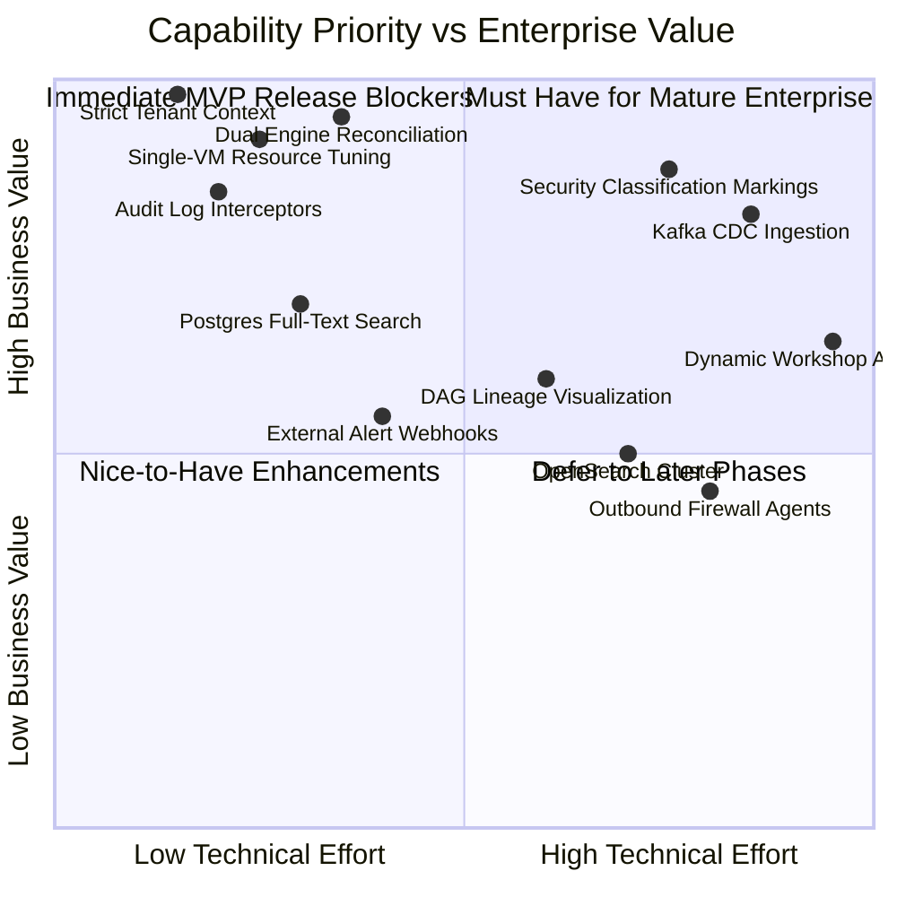

# LuminAI vs. Palantir Foundry: Comprehensive Feature Gap Analysis

**Document Version:** 1.0.0  
**Audit Date:** November 2026  
**Auditor:** Senior Principal Enterprise Architect & DevSecOps Lead  
**Benchmark Product:** Palantir Foundry  

---

## Executive Overview

Palantir Foundry represents the industry standard for enterprise data operating systems. It combines multi-source connectivity, automated schema inference, declarative pipeline orchestration, entity resolution, an extensible semantic ontology, granular role- and marking-based access control, and bidirectional operational interfaces.

This document systematically benchmarks LuminAI against Palantir Foundry across 14 architectural capabilities. The objective is not to replicate every enterprise feature of Foundry on day one, but to establish:
1. **Current State:** What LuminAI currently implements in code.
2. **Foundry Benchmark:** How Foundry solves the problem.
3. **Gap Severity:** The business and technical risk of the discrepancy.
4. **Minimal MVP Requirement:** The smallest technically credible implementation required for LuminAI's first production deployment.
5. **Mature Enterprise Requirement:** What must be added in subsequent quarters to achieve enterprise parity.

---

## Capability Evaluation Matrix

```
Severity Key:
  [CRITICAL] Blocker for production release; integrity or security failure without it.
  [HIGH]     Major capability deficit; manual intervention required.
  [MEDIUM]   Functional limitation acceptable for private pilot, unacceptable for broad enterprise.
  [LOW]      Value-add enhancement or operational convenience.
```

---

### 1. Data Connectivity and Source Integration

| Dimension | Palantir Foundry Benchmark | LuminAI Current State | Gap Severity |
| :--- | :--- | :--- | :--- |
| **Supported Connectors** | 100+ native connectors (JDBC, Snowflake, SAP, Salesforce, S3, Kafka, REST, BigQuery). | Direct CSV, JSON, and ZIP upload; single-host PostgreSQL connector with JDBC metadata extraction. Prototype mock schema generator. | **[HIGH]** |
| **Credential Management** | Foundry Data Connection agent with encrypted KMS secrets, dynamic credential rotation, and mutual TLS. | AES-256 Vault encryption (`VaultService.java`), but hardcoded default key was present in prod config prior to remediation. | **[MEDIUM]** |
| **Network Topology** | Secure agents deployed behind corporate firewalls / private VPCs polling out to Foundry control plane. | Direct inbound HTTP connections; backend must directly reach source DB over network. | **[MEDIUM]** |

#### Minimal MVP Requirement
- Keep CSV, JSON, and ZIP file uploads.
- Harden the single PostgreSQL JDBC connector to validate connection pooling, TLS certificates, and read-only user enforcement.
- Decommission mock schema generation in `ConnectionController.java`.

#### Mature Enterprise Requirement
- Connector plugins for MySQL, SQL Server, and Amazon S3.
- Outbound polling agent architecture for on-premises enterprise firewalls without exposing database ports.

---

### 2. Data Ingestion and Synchronization

| Dimension | Palantir Foundry Benchmark | LuminAI Current State | Gap Severity |
| :--- | :--- | :--- | :--- |
| **Ingestion Modes** | Snapshot (batch full overwrite), Append (incremental transactions), and Streaming (real-time Kafka/Kinesis CDC). | Batch file upload and manual table extraction. Kafka producer streams `ingest.raw` topic, but Kafka is disabled in production lightsail override. | **[HIGH]** |
| **Payload Storage** | Raw data landed in object storage (Foundry File System / S3) with immutable transaction IDs. | MinIO S3-compatible storage with fallback to in-memory byte buffers if MinIO is offline. | **[MEDIUM]** |
| **Sync Scheduling** | Cron, trigger-on-arrival, and event-driven pipeline builds with automated backpressure. | Manual UI upload trigger and Dagster `@schedule` definitions in `schedules.py` (daily/hourly). | **[LOW]** |

#### Minimal MVP Requirement
- File ingestion landing in MinIO / S3 with deterministic object keys (`{tenant_id}/raw/{connection_id}/{timestamp}_{filename}`).
- Synchronous fallback to local storage or Direct DuckDB processing if Kafka is disabled on low-cost single-node infrastructure.

#### Mature Enterprise Requirement
- Change Data Capture (CDC) via Debezium into Kafka for real-time relational replication.
- Partitioned S3 raw data landing with automatic lifecycle expiration.

---

### 3. Data Transformation and Normalization

| Dimension | Palantir Foundry Benchmark | LuminAI Current State | Gap Severity |
| :--- | :--- | :--- | :--- |
| **Transformation Engines** | PySpark, SQL, Flink, and Polars integrated with unified build system (Foundry Transform). | **Dual divergent engines:**<br>1. Java in-memory string manipulation (`toTitleCase`, lowercase emails) in `ConnectionCleanPreviewService`.<br>2. Polars + DuckDB pipeline in Python `data-engine` (`cleaning_pipeline`). | **[CRITICAL]** |
| **Schema Normalization** | Strict schema enforcement, type casting, date normalization, unit conversion, and null handling. | `schema_detector.py` infers types with confidence scores; `cleaning_pipeline` performs date normalization and null sanitization. | **[MEDIUM]** |
| **Deduplication & Entity Resolution** | Native Foundry ER with customizable matching rules, probabilistic ML resolution, and human review queues. | Jaro-Winkler, Levenshtein, and semantic embedding blocking (`blocking.py`, `comparison.py`, `clustering.py`). Frontend merge review page exists. | **[LOW]** |

#### Minimal MVP Requirement
- **Decommission Java in-memory cleaning:** Route all data cleaning exclusively through the Python `data-engine` via REST call (`/process/clean`) or Dagster materialization.
- Ensure the frontend clean preview reads from the actual cleaned output of `data-engine` rather than ad-hoc Java heuristics.

#### Mature Enterprise Requirement
- User-configurable transformation DSL (SQL-based or visual node pipeline) stored in metadata database and executed by DuckDB.
- Feedback loop where human merge/unmerge decisions train resolution classifiers.

---

### 4. Data Pipeline Orchestration

| Dimension | Palantir Foundry Benchmark | LuminAI Current State | Gap Severity |
| :--- | :--- | :--- | :--- |
| **Orchestrator** | Foundry Build Service: transactional DAG builds, automatic dependency tracking, input change detection. | In-process Dagster (`dagster.materialize`) called from FastAPI background tasks. Run tracker in SQLite/PostgreSQL. | **[MEDIUM]** |
| **Daemon & Web UI** | Integrated pipeline monitor with job graphs, live logs, step metrics, and cancel/retry capabilities. | `dagster-daemon` and `dagster-webserver` defined in Docker Compose, but disabled (`replicas: 0`) in Lightsail production override. | **[HIGH]** |
| **Checkpointing & Retry** | Step-level caching, state checkpoints, and idempotent task retries. | `checkpoint.py` stores intermediate DuckDB parquet files; `/process/retry/{run_id}` resumes from failed steps. | **[LOW]** |

#### Minimal MVP Requirement
- Maintain in-process `DagsterTrigger` execution inside `data-engine` to fit within single VM memory limits (2GB-4GB).
- Expose run progress and error logs through existing `/process/status/{run_id}` API to the React frontend `PipelinePage`.

#### Mature Enterprise Requirement
- Standalone Dagster daemon with Celery / Redis queue workers for multi-node horizontal job execution.

---

### 5. Data Quality and Validation

| Dimension | Palantir Foundry Benchmark | LuminAI Current State | Gap Severity |
| :--- | :--- | :--- | :--- |
| **Quality Gates** | Pre-build and post-build data expectations, null threshold checks, schema assertions, anomaly alerts. | 4 Dagster `@asset_check` definitions: `cleaning_min_row_count_check`, `cleaning_max_null_percentage_check`, `cleaning_value_range_check`, `er_referential_integrity_check`. | **[LOW]** |
| **Quarantine & Poison Queues** | Automated dead-letter queues (DLQ), quarantined partition isolation, notification alerts. | `quarantine.py` captures invalid rows, stores them in SQLite/PostgreSQL `quarantined_records`, with retry API. | **[LOW]** |

#### Minimal MVP Requirement
- Quality gates and quarantine are already well-implemented in `data-engine`. Ensure quarantine metrics appear on the frontend Dashboard.

#### Mature Enterprise Requirement
- User-defined quality rules configurable through the React UI without redeploying code.

---

### 6. Data Cataloguing and Metadata Management

| Dimension | Palantir Foundry Benchmark | LuminAI Current State | Gap Severity |
| :--- | :--- | :--- | :--- |
| **Catalog Explorer** | Global dataset search, schema viewer, documentation markdown, tag hierarchies, usage statistics. | React `ExplorerPage` with search debounce, connection filters, and dataset previews. | **[MEDIUM]** |
| **Search Engine** | Distributed OpenSearch / Elasticsearch indexing metadata, descriptions, schemas, and values. | OpenSearch is configured in local Docker Compose, but disabled in production (`docker-compose.prod.yml`) to conserve RAM. | **[MEDIUM]** |

#### Minimal MVP Requirement
- PostgreSQL full-text search (`tsvector` / `tsquery` on `connections`, `golden_records`, and `entity_types`) as a lightweight, zero-RAM alternative to OpenSearch.

#### Mature Enterprise Requirement
- OpenSearch / Elasticsearch cluster for cross-tenant fuzzy search across millions of records.

---

### 7. Data Lineage and Provenance

| Dimension | Palantir Foundry Benchmark | LuminAI Current State | Gap Severity |
| :--- | :--- | :--- | :--- |
| **Lineage Tracking** | End-to-end dataset and column-level DAG lineage from raw ingestion to final operational dashboard. | `provenance` table in `data-engine` records `source_id`, `run_id`, `input_record_id`, and `golden_id`. | **[MEDIUM]** |
| **Lineage Visualization** | Interactive DAG graph showing upstream/downstream dependencies, stale builds, and impacted assets. | Cytoscape.js is integrated in frontend (`GraphPage`, `GraphCanvas.tsx`), but currently visualizes entity relationship graphs (Neo4j), not pipeline asset lineage. | **[HIGH]** |

#### Minimal MVP Requirement
- Connect existing Cytoscape canvas to display dataset lineage: Connection → Staging → Cleaned → Golden Record.

#### Mature Enterprise Requirement
- Column-level lineage tracing transformations applied to individual fields across pipeline versions.

---

### 8. Unified Data Models & Semantic Representation (Foundry Ontology)

| Dimension | Palantir Foundry Benchmark | LuminAI Current State | Gap Severity |
| :--- | :--- | :--- | :--- |
| **Object Types & Properties** | Foundry Ontology: user-defined Object Types, properties, primary keys, title keys, and validation rules. | `EntityType` entity in Spring Boot (`id`, `name`, `displayName`, `propertiesJson`, `status`); React `OntologyPage` and `EntityTypeEditor`. | **[LOW]** |
| **Link Types & Graph Engine** | Native graph links between Object Types backed by high-scale graph database. | Neo4j integration (`Neo4jGraphRepository.java`), Cypher queries for nodes and relationships (`SAME_CATEGORY`, `MEMBER_OF`). | **[LOW]** |
| **Action Types & Edits** | Ontology Actions: transactional mutations that modify objects, trigger side effects, and audit history. | Not implemented. Editing an entity in LuminAI is standard REST CRUD on `GoldenRecord`. | **[MEDIUM]** |

#### Minimal MVP Requirement
- Maintain current `EntityType` definition and Neo4j graph visualization.
- Ensure entity type property mappings match the output schema of cleaned datasets.

#### Mature Enterprise Requirement
- Action Types enabling users to trigger external webhooks, approval workflows, or database writebacks directly from ontology entities.

---

### 9. Analytics and Data Exploration

| Dimension | Palantir Foundry Benchmark | LuminAI Current State | Gap Severity |
| :--- | :--- | :--- | :--- |
| **Visual Analytics** | Foundry Contour (visual point-and-click data path analysis) and Quiver (advanced time-series and graph exploration). | React ECharts dashboards (`DashboardPage.tsx`), Cytoscape graph exploration (`GraphPage.tsx`), tabular explorer (`ExplorerPage.tsx`). | **[LOW]** |
| **Ad-Hoc Query Engine** | Spark SQL / ClickHouse ad-hoc SQL engine with query federation across heterogeneous sources. | DuckDB SQL query execution in `data-engine` (`analytics_engine.py`) and PostgreSQL queries via JPA. | **[LOW]** |

#### Minimal MVP Requirement
- Current dashboards, graph canvas, and DuckDB analytical query endpoints are sufficient for initial pilot releases.

#### Mature Enterprise Requirement
- Custom dashboard builder enabling users to save query charts, widgets, and filters into shareable reports.

---

### 10. Application and API Delivery

| Dimension | Palantir Foundry Benchmark | LuminAI Current State | Gap Severity |
| :--- | :--- | :--- | :--- |
| **API Endpoints** | Foundry REST & Webhook APIs with OpenAPI specs, SDK generators (TypeScript, Python), and rate limiting. | Spring Boot REST API (`/api/v1/*`), FastAPI REST API (`/process/*`, `/analytics/*`), OpenAPI Swagger docs at `/swagger-ui.html` and `/docs`. | **[LOW]** |
| **Application Builder** | Foundry Workshop (no-code application builder creating custom business applications on top of the ontology). | Pre-built React Single Page Application (SPA). No dynamic no-code app generator. | **[LOW]** |

#### Minimal MVP Requirement
- REST API and Swagger documentation are functional and complete for programmatic integration.

#### Mature Enterprise Requirement
- Dynamic form generator enabling non-technical users to build lightweight task applications around specific entity types.

---

### 11. Identity Management and Access Control (IAM/RBAC)

| Dimension | Palantir Foundry Benchmark | LuminAI Current State | Gap Severity |
| :--- | :--- | :--- | :--- |
| **Authentication** | SAML 2.0, OIDC, SCIM user provisioning, MFA, Active Directory sync. | Keycloak OIDC (`/realms/luminai`), OAuth2 Resource Server JWT validation, API Key SHA-256 header authentication. | **[LOW]** |
| **Role-Based Access Control** | Granular RBAC (`PLATFORM_ADMIN`, `TENANT_ADMIN`, `DATA_ENGINEER`, `OPERATOR`, `USER`, `VIEWER`). | Enforced via Spring Security `@PreAuthorize("hasAnyRole(...)")` across all controllers. | **[LOW]** |
| **Multi-Tenant Separation** | Projects, organizations, and security markings isolating customer tenants. | PostgreSQL schema isolation (`tenant_{slug}`), Keycloak tenant scoping, `TenantContext` ThreadLocal propagation. | **[HIGH]** *(Remediated)* |

#### Minimal MVP Requirement
- Strict enforcement of `TenantContext` without fallback to default tenants (completed in Fixes 1, 2, 3).
- Automated creation of PostgreSQL schema `tenant_{slug}` on tenant registration.

#### Mature Enterprise Requirement
- Column-level and row-level security policies (e.g. masking PII columns based on user role).

---

### 12. Data Governance and Security

| Dimension | Palantir Foundry Benchmark | LuminAI Current State | Gap Severity |
| :--- | :--- | :--- | :--- |
| **Security Markings** | Mandatory Access Control (MAC) with cryptographic classification markings (e.g. Secret, Top Secret, PII). | Not implemented. Security is role-based and tenant-scoped; no individual marking labels on records. | **[HIGH]** *(for Gov/Defense)* |
| **Audit Logging** | Immutable tamper-evident audit log recording every view, query, export, and transformation. | JPA `AuditLog` entity in PostgreSQL, structured JSON logging in FastAPI with correlation `run_id` and `tenant_id`. | **[MEDIUM]** |
| **Encryption at Rest & In Transit** | End-to-end TLS 1.3, envelope encryption with customer-managed keys (AWS KMS / HashiCorp Vault). | AES-256 Vault encryption (`VaultService.java`), TLS on Redis/Postgres in prod config. | **[MEDIUM]** |

#### Minimal MVP Requirement
- Intercept all export events (e.g. `exportCleanCsv`) and log them to the `audit_logs` table with timestamp, user ID, tenant ID, and IP address.
- Require non-default `VAULT_ENCRYPTION_KEY` in production (completed in Fix 4).

#### Mature Enterprise Requirement
- Granular data classification tags (e.g. `CONFIDENTIAL`, `RESTRICTED`) that restrict export actions regardless of tenant role.

---

### 13. Monitoring and Operational Management

| Dimension | Palantir Foundry Benchmark | LuminAI Current State | Gap Severity |
| :--- | :--- | :--- | :--- |
| **Observability** | Integrated telemetry, Prometheus metrics, distributed tracing across microservices, health dashboards. | Spring Boot Actuator (`/actuator/health`, `/actuator/metrics`), OpenTelemetry SDK in Python `data-engine` (`app/telemetry.py`), Prometheus metrics exporter. | **[LOW]** |
| **Alerting** | PagerDuty, Slack, email alerts on pipeline failure or threshold breach. | Exception logging to stderr; no automated outbound webhook or email alerting service. | **[MEDIUM]** |

#### Minimal MVP Requirement
- Spring Boot Actuator and FastAPI `/health` endpoints monitored by Docker Compose health checks.

#### Mature Enterprise Requirement
- Outbound alert webhooks (Slack/Email) on pipeline failure or quarantine spike.

---

### 14. Scalability, Reliability, and Infrastructure Budget

| Dimension | Palantir Foundry Benchmark | LuminAI Current State | Gap Severity |
| :--- | :--- | :--- | :--- |
| **Cluster Architecture** | Kubernetes cluster (EKS/GKE), auto-scaling Spark executors, distributed object storage, managed DBs. | Docker Compose multi-container stack; pruned for single VM AWS Lightsail deployment (~$40-$60/mo, ~$700/yr). | **[HIGH]** |
| **Memory Footprint** | Enterprise footprint: 64GB-512GB RAM clusters across tens of nodes. | Low-cost target: 2GB-4GB RAM single instance. Heavy services (Kafka, Zookeeper, OpenSearch) disableable. | **[CRITICAL]** |

#### Minimal MVP Requirement
- **Single-Node Low Cost Architecture (~GHS 10,000 / ~$700/yr):**
  - Run `core-backend` (Spring Boot, 512MB RAM heap limits).
  - Run `data-engine` (FastAPI + DuckDB + Polars, 512MB RAM limits).
  - Run PostgreSQL 16 (shared multi-schema, 512MB RAM limits).
  - Run Redis (256MB RAM cache).
  - Run Keycloak (512MB RAM).
  - Serve frontend static build directly via Nginx reverse proxy.
  - Disable Kafka/Zookeeper/OpenSearch/Dagster-daemon on Lightsail; use direct REST invocation and DuckDB in-process processing.

#### Mature Enterprise Requirement
- Migration to Amazon EKS / RDS Aurora Multi-AZ when monthly customer revenue justifies >$1,000/mo infrastructure spend.

---

## Strategic Summary: Capability Prioritization



1. **Immediate Release Blockers (Addressed / In Progress):**
   - Tenant isolation fail-closed enforcement.
   - Clean preview synchronization with Python DuckDB engine.
   - Elimination of mock schemas and hardcoded fallbacks.
   - Single-host AWS Lightsail resource consolidation.
2. **Phase 2 (Customer Beta):**
   - Direct Cytoscape pipeline lineage view.
   - Comprehensive audit logging on dataset export.
   - PostgreSQL full-text search indexing.
3. **Phase 3 (Enterprise Scale):**
   - Kafka CDC streaming connectors.
   - Security classification markings for government clients.
   - Multi-node Dagster cluster and OpenSearch indexer.

