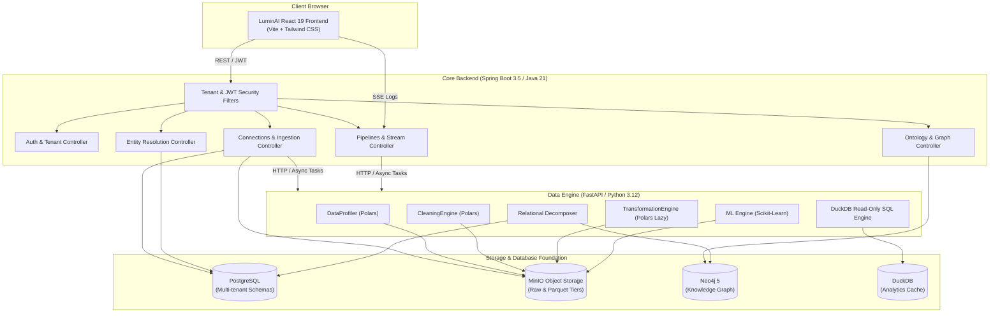

# LuminAI Architecture & Technical Discovery

## 1. System Overview

LuminAI is an enterprise data operating system structured across three core tiers:
1. **Frontend Tier (`/frontend`)**: A React 19 Single Page Application built with Vite, TypeScript, and Tailwind CSS. It communicates with both the Core Backend and Data Engine via authenticated REST APIs and Server-Sent Events (SSE).
2. **Core Backend Tier (`/core-backend`)**: A Spring Boot 3.5 Java application running on JDK 21. It serves as the primary system of record, owning multi-tenant isolation, user identity, dataset metadata, ontology definitions, entity resolution state, and audit logs backed by PostgreSQL and Flyway migrations.
3. **Data Engine Tier (`/data-engine`)**: A high-performance Python 3.12 service leveraging FastAPI, Polars, DuckDB, Scikit-learn, and Dagster. It handles streaming and lazy tabular ingestion, statistical profiling, data cleaning recipes, transformation pipelines, SQL analytics, model training, and relational graph decomposition.
4. **Data Persistence Tier**:
   - **PostgreSQL**: Stores relational metadata, users, tenants, cleaning rules, pipeline runs, entity resolution candidates, and golden records (`golden_records` table with JSONB attributes).
   - **MinIO (S3-Compatible Object Store)**: Stores raw ingested files, intermediate transformation checkpoints, immutable curated Parquet datasets, and serialized machine learning model artifacts (`.joblib` / `.pkl`).
   - **Neo4j**: Stores the enterprise knowledge graph consisting of ontological entities (nodes) and their semantic, verified relationships (edges).
   - **DuckDB**: Provides embedded zero-copy SQL analytics directly over local parquet files and memory-mapped DataFrames.

---

## 2. Architectural Diagram



---

## 3. Storage Hierarchy & Lifecycle Stages

Data flows through four strictly governed tiers in LuminAI:

```
[Raw Storage Tier]
   │  Path: storage/raw/{tenant_id}/{connection_id}/{filename}
   │  Characteristics: Immutable original upload (CSV, TSV, JSON, XLSX, XML).
   │  Access: Read-only, source of truth for replayability.
   ▼
[Working / In-Flight Tier]
   │  Path: storage/checkpoints/{job_id}/
   │  Characteristics: Intermediate Polars DataFrames during cleaning and transformation.
   │  Access: Ephemeral, cleaned up upon job completion or failure.
   ▼
[Curated Data Foundation]
   │  Path: storage/curated/{tenant_id}/{dataset_id}/v{version}.parquet
   │  Characteristics: Validated, strongly-typed, Snappy-compressed Parquet files.
   │  Access: Registered in DuckDB and PostgreSQL dataset catalog.
   ▼
[Operational & Serving Tier]
   ├── Analytics: DuckDB memory tables for instantaneous SQL queries.
   ├── Knowledge Graph: Entity nodes & relationships indexed in Neo4j.
   ├── Entity Explorer: Golden records with JSONB properties in PostgreSQL.
   └── ML Models: Serialized champion pipelines in MinIO ready for inference.
```

---

## 4. Multi-Tenant Isolation Architecture

LuminAI employs schema-based multi-tenancy in PostgreSQL combined with bucket/prefix partitioning in MinIO and label isolation in Neo4j:
- **PostgreSQL**: Each tenant executes within a dedicated PostgreSQL schema (`tenant_<tenant_id>`). Schema search paths are safely set and reset per connection pool checkout (`SET search_path TO tenant_x, public`).
- **MinIO**: Objects are stored with tenant-prefixed keys (`{tenant_id}/...`). Storage access tokens and pre-signed URLs are scoped strictly to the calling tenant's prefix.
- **Neo4j**: Every node and edge is labeled with `tenant_id` and indexed. Graph queries strictly enforce `WHERE n.tenant_id = $tenantId` on all traversals and shortest-path calculations.
- **Data Engine**: All FastAPI requests require an `X-Tenant-ID` header and JWT Bearer token validated by `app/security.py`.

---

## 5. Relational Decomposition Flow

When flat enterprise files (e.g., transactional orders containing customer names, shipping addresses, payment details, and product SKUs) are ingested:
1. **Schema Studio** (`/connections/schema-map`): The user or auto-mapper defines mappings between table columns and target ontology entity types (`Customer`, `Order`, `Product`, `Location`).
2. **Decomposition Execution** (`/api/v1/graph/decompose-and-sync`):
   - The `RelationalDecomposer` in `app/processing/er/relational_decomposer.py` streams the dataset using Polars.
   - Distinct entity records are extracted and deduplicated using deterministic primary keys (e.g. `customer_id`, `product_sku`).
   - Foreign-key relationships are converted into directed semantic edges (`[:PLACED]`, `[:CONTAINS]`, `[:SHIPPED_TO]`).
   - Entity golden records are inserted into PostgreSQL `golden_records`.
   - Entity nodes and semantic edges are synced in batches to Neo4j.
3. **Graph Intelligence** (`/graph`): The Cytoscape.js canvas queries Neo4j to visualize the resulting interconnected enterprise topology.
