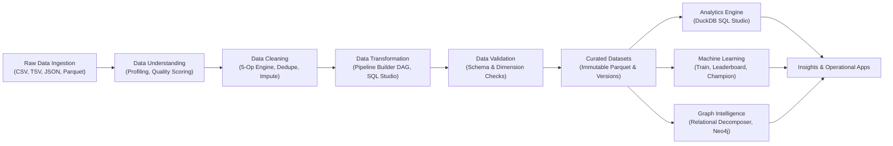

# LuminAI Feature, Module & Capability Inventory

## 1. Executive Summary

This inventory documents all 25 operational capability areas across the three foundational layers of **LuminAI**:
1. **Core Backend (Spring Boot 3.5 / Java 21 / PostgreSQL)**: Owns authentication, multi-tenancy, persistence, ingestion orchestration, ontology, entity resolution, and audit logs.
2. **Data Engine (Python 3.12 / Polars / DuckDB / Scikit-Learn)**: Owns data profiling, cleaning execution, transformation pipelines, SQL execution engine, machine learning lifecycle, and relational decomposition.
3. **Frontend (React 19 / Vite / Tailwind CSS)**: Owns the user interface, interactive workflows, visual ontology modeling, pipeline graph builder, model leaderboard, and knowledge graph exploration canvas.

---

## 2. Complete Capabilities & Endpoint Inventory

| ID | Feature / Module | Frontend Route | Backend REST Endpoints | Data Engine Endpoints / Logic | Input Contracts | Output Contracts | Test Priority |
| :--- | :--- | :--- | :--- | :--- | :--- | :--- | :--- |
| **CAP-01** | **Authentication & Session** | `/login`, `/auth/callback` | `GET /api/v1/auth/me`, `POST /api/v1/internal/users` | N/A (JWT Bearer Token validation) | Username, Password / OAuth code | JWT Bearer Token, Tenant Context | P0 |
| **CAP-02** | **Tenant & Project Isolation** | `/admin/tenants`, `/projects` | `POST /api/v1/admin/tenants`, `GET/POST /api/v1/projects`, `GET /api/v1/projects/summary` | Multi-tenant schema routing (`tenant_id` header) | Tenant name, Slug, Description | Tenant Object, Scoped Schema | P0 |
| **CAP-03** | **Connections & Ingestion** | `/connections` | `GET/POST /api/v1/connections`, `POST /api/v1/connections/{id}/upload`, `POST /api/v1/connections/discover` | `app/api/datasets_api.py` (Parser & S3 Ingest) | File multipart (CSV, TSV, JSON, XLSX, XML) or DB URI | Connection DTO, Ingestion Task ID | P0 |
| **CAP-04** | **Data Profiling & Schema Inference** | `/datasets/$datasetId` | `GET /api/v1/datasets/{id}/profile`, `GET /api/v1/datasets/{id}/quality` | `GET /api/v1/engine/profile`, `DataProfiler` in `profiler.py` | Dataset ID, Sample limit | Column types, null %, min, max, mean, quantiles | P0 |
| **CAP-05** | **Data Cleaning Recipe & Execution** | `/connections` (Clean modal), `/datasets` | `GET/POST/PUT/DELETE /api/v1/connections/{id}/cleaning-rules`, `POST /api/v1/engine/process/clean` | `POST /api/v1/engine/clean-preview`, `CleaningEngine` | 5 operations: `remove_missing`, `fill_missing`, `standardize_text`, `deduplicate`, `handle_outliers` | Cleaned Dataset, Before/After Diff, Audit Telemetry | P0 |
| **CAP-06** | **Dataset Catalog & Versioning** | `/datasets`, `/datasets/$datasetId` | `GET/POST /api/v1/datasets`, `GET /api/v1/datasets/{id}/versions`, `POST /api/v1/datasets/{id}/versions` | MinIO Parquet storage, DuckDB table registration | Dataset metadata, Tag, Retention tier | Immutable Parquet Artifacts, Version Hash | P0 |
| **CAP-07** | **Ontology & Entity Types** | `/ontology` | `GET/POST/PUT/DELETE /api/v1/ontology/entity-types`, `POST /api/v1/ontology/entity-types/auto-generate` | `schema_detector/ontology.py` | Entity Type Name, Primary Key, Attributes, Color/Icon | Golden Entity Definition, Neo4j Schema | P1 |
| **CAP-08** | **Ontology Relationships** | `/ontology` | `GET/POST/PUT/DELETE /api/v1/ontology/relationships` | Neo4j Relationship schema | Source Entity, Target Entity, Verb/Cardinality | Edge Definition, Graph Index | P1 |
| **CAP-09** | **Visual Schema Studio** | `/connections/schema-map` | `GET/POST /api/v1/connections/{id}/mapping`, `POST /api/v1/graph/decompose` | `RelationalDecomposer` in `relational_decomposer.py` | Source flat schema -> Ontology Entity mappings | Decomposition Rules, Node/Edge extraction specs | P0 |
| **CAP-10** | **Relational Decomposition & Graph Sync** | `/connections/schema-map`, `/graph` | `POST /api/v1/graph/decompose-and-sync`, `POST /api/v1/graph/sync/decomposed` | `relational_decomposer.py`, Neo4j Driver | Flat tabular dataset + Decomposition spec | Golden Records in Postgres + Nodes/Edges in Neo4j | P0 |
| **CAP-11** | **Entity Resolution & Deduplication** | `/connections/merge-review` | `GET/POST /api/v1/er/candidates`, `POST /api/v1/er/candidates/scan`, `POST /api/v1/er/candidates/{id}/resolve` | `app/processing/er/pipeline.py` (Dedupe / RecordLinkage) | Blocking rules, Similarity thresholds (Jaro-Winkler) | Candidate Pairs, Merge/Keep Decisions, Golden Record | P0 |
| **CAP-12** | **Merge Review & Manual Audit** | `/connections/merge-review` | `GET /api/v1/er/candidates/{id}`, `POST /api/v1/er/candidates/{id}/resolve` | Entity reconciliation engine | Approve merge, Reject, Split | Updated Golden Record, Merge Provenance Log | P1 |
| **CAP-13** | **Visual Pipeline Builder** | `/connections/pipeline` | `GET/POST/PUT /api/v1/pipelines`, `POST /api/v1/pipelines/execute` | `POST /api/v1/pipelines/execute` in `pipelines_builder_api.py` | Directed Acyclic Graph (DAG) of transformation nodes | Pipeline Definition, Compiled Execution Plan | P0 |
| **CAP-14** | **Data Transformations Engine** | `/connections/pipeline` | `POST /api/v1/pipelines/execute` | `TransformationEngine` (Polars lazy evaluation) | Operations: FILTER, SELECT, DROP, RENAME, DERIVE, JOIN, GROUP_BY, SORT, DEDUPLICATE | Transformed DataFrame, Lineage Manifest | P0 |
| **CAP-15** | **SQL Studio & Analytics** | `/analytics/sql` | `POST /api/v1/analytics/sql/execute`, `GET /api/v1/analytics/sql/tables` | `POST /api/v1/engine/sql` (DuckDB read-only) | ANSI SQL query (SELECT only, AST security check) | Tabular result set, Execution time, Memory footprint | P0 |
| **CAP-16** | **Data Lineage & Graph Provenance** | `/projects`, `/explorer/$entityId` | `GET /api/v1/lineage/{entityId}`, `GET /api/v1/explorer/entities/{id}/provenance` | Lineage Graph Builder (Ingestion -> Clean -> Transform -> ML) | Entity ID / Dataset ID | Node & Edge Lineage Directed Graph | P1 |
| **CAP-17** | **Machine Learning Studio** | `/datascience/models` | `POST /api/v1/ml/train`, `GET /api/v1/ml/leaderboard`, `POST /api/v1/ml/models/register` | `ml_engine.py` (Random Forest, LogReg, LinReg, KMeans) | Dataset ID, Target column, Features, Hyperparameters | Model Run Metrics (F1, AUC, RMSE), Artifact ID | P0 |
| **CAP-18** | **ML Champion Promotion & Registry** | `/datascience/models` | `POST /api/v1/ml/champion`, `GET /api/v1/ml/models/{id}/artifact` | Model artifact serialization (joblib/pickle) in MinIO | Model ID, Scope, Justification | Promoted Champion Flag, Serving Endpoint | P1 |
| **CAP-19** | **Knowledge Graph Exploration** | `/graph` | `GET /api/v1/graph`, `GET /api/v1/graph/overview`, `GET /api/v1/graph/stats` | Cypher query runner against Neo4j instance | Entity Type filter, Search query, Hop depth | Graph Nodes, Edges, Neighborhood Topology | P0 |
| **CAP-20** | **Graph Shortest Path & Analysis** | `/graph` | `GET /api/v1/graph/shortest-path` | Neo4j Dijkstra / BFS shortest path algorithm | Source Node ID, Target Node ID | Path sequence of nodes and connecting relationships | P1 |
| **CAP-21** | **Entity Explorer & Facet Search** | `/explorer`, `/explorer/$entityId` | `GET /api/v1/explorer/search`, `GET /api/v1/explorer/entities/{id}` | Elastic/Postgres full-text search with JSONB indexing | Search string, Entity type, Facet filters | Paginated Entity Cards, Detailed Property Grid | P0 |
| **CAP-22** | **Executive Dashboard & Telemetry** | `/` | `GET /api/v1/dashboard/summary`, `GET /api/v1/engine/metrics` | Prometheus client metrics exporter | N/A | Total records, System status, Alerts, Pipeline load | P1 |
| **CAP-23** | **Pipeline Monitoring & Live Logs** | `/connections/pipelines` | `GET /api/v1/pipelines`, `GET /api/v1/pipelines/stream` (SSE), `GET /api/v1/pipelines/runs/{id}` | Dagster / Background event bus | Filter by status (COMPLETED, FAILED, RUNNING) | Live Event Stream, Run Duration, Error Backtraces | P1 |
| **CAP-24** | **System Settings & API Key Mgmt** | `/settings` | `GET /api/v1/settings/api-keys`, `POST /api/v1/settings/api-keys/rotate` | Key rotation & hashing service | Key name, Expiration, Scopes | Masked Key String, Audit Event | P2 |
| **CAP-25** | **Security & Access Control** | `/admin/users`, `/admin/tenants` | Keycloak OpenID Connect + Spring Security RBAC | `app/security.py` (Tenant context validation) | Bearer token, User credentials | Roles (`ADMIN`, `ENGINEER`, `ANALYST`, `VIEWER`) | P0 |

---

## 3. Supported File Ingestion Matrix

| Format | Extension | Parser Library | Delimiters / Variants Supported | Large File Strategy | Edge-Cases Handled |
| :--- | :--- | :--- | :--- | :--- | :--- |
| **CSV** | `.csv` | Polars / DuckDB | Comma `,`, Semicolon `;`, Pipe `\|` | Streaming Chunked Read (`pl.scan_csv`) | Embedded newlines inside quotes, UTF-8 BOM, escaped quotes |
| **TSV** | `.tsv` | Polars / DuckDB | Tab `\t` | Streaming Chunked Read | Embedded spaces, empty strings vs nulls |
| **JSON** | `.json` | Polars / Python `orjson` | Standard array of JSON objects | In-memory with fallback to streaming reader | Nested structures, Unicode emojis, empty objects |
| **JSON Lines** | `.jsonl`, `.ndjson` | Polars / DuckDB | Newline-delimited JSON objects | Polars Lazy NDJSON reader (`pl.scan_ndjson`) | Trailing empty lines, malformed JSON lines recovery |
| **Parquet** | `.parquet` | Polars / PyArrow | Snappy, Gzip, ZSTD compression | Zero-copy Arrow columnar reader | Complex dictionary types, high-precision timestamps |
| **Excel** | `.xlsx`, `.xls` | OpenPyXL / Calamine | Multi-sheet workbooks, header offsets | Sheet selection, memory streaming | Formatted numbers as text, date serial codes |
| **XML** | `.xml` | `defusedxml` / ElementTree | Hierarchical record elements | Streaming event parser (`iterparse`) | XXE injection prevention, CDATA tags |

---

## 4. End-to-End Governed Foundation Flow

The complete data lifecycle within LuminAI follows this strict lineage:

